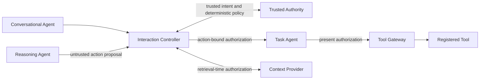

# CAAIF Core — Context-Aware Agent Interaction Framework

**v0.1.0rc1 · Developer preview candidate · INTERNAL / NOT YET LICENSED FOR PUBLIC DISTRIBUTION**

CAAIF is an experimental Python SDK for **independently controlled agent collaboration** and **minimum-necessary context disclosure**. It supports local and localhost HTTP examples, with optional adapters for LangGraph and Microsoft Agent Framework. The **Conversational–Reasoning–Task** role split is an optional *enforceable reference profile*, not a universal requirement of the Core.

## The security boundary

**A model-generated decision is only a proposal.** For protected actions, use the **guarded profile**: a trusted application registers an intent; CAAIF compares a Reasoning Agent proposal against that intent and independently evaluates policy; a separate Tool Gateway validates an action-bound permit at execution. Context references never grant access by themselves, and retrieval must be authorized. The earlier `LocalController.issue_decision(...authorized=True)` path remains for compatibility **but must not be used to protect side effects**.



## Try it locally (source checkout)

```bash
python3 -m venv .venv
.venv/bin/python -m pip install -e .
.venv/bin/python examples/sdk_guarded_three_agent_demo.py
.venv/bin/python examples/sdk_guarded_distributed_v013_demo.py
.venv/bin/python tools/run_sdk_tests.py --timeout 75
```

Optional real framework adapters: `.venv/bin/python -m pip install -e '.[interop]'` then run `examples/sdk_cross_framework_v04_demo.py`. The guarded demos use deterministic agents and synthetic data, not live LLMs.

## Read first

- [Installation and developer preview checklist](INSTALL_RC1.md)
- [Guarded profile specification](spec/GUARDED_DISTRIBUTED_PROFILE_V013.md)
- [Trust architecture and authorization semantics](spec/TRUST_ARCHITECTURE_DRAFT3.md)
- [Security limitations](SECURITY.md) and [release security gates](docs/RC1_SECURITY_ASSESSMENT.md)
- [Full release checklist](RELEASE_CHECKLIST.md)
- [Experimental findings and reproducibility](docs/RC1_EVIDENCE.md)

## Status and limitations

Local tests cover untrusted proposals, action binding, revocation, replay denial, context access, and deterministic cross-framework adapters. No production-grade workload identity, TLS/WAN deployment security, multi-node durable replay protection, independent security audit, real-model prompt-injection suite or equivalent-control A2A benchmark has been completed. Earlier synthetic loopback byte savings should **not** be interpreted as proven real-world superiority.

**Licensing:** Apache-2.0 is **proposed but not yet granted**. `LICENSE.Apache-2.0.PROPOSED` is not an active `LICENSE`; copyright/provenance and owner approval remain mandatory before public source distribution. No GitHub or PyPI publication is performed by this candidate.
