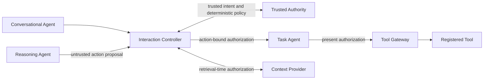

# CAAIF Core — Context-Aware Agent Interaction Framework

**v0.1.0rc1 · Developer preview candidate · INTERNAL / NOT YET LICENSED FOR PUBLIC DISTRIBUTION**

CAAIF is an experimental Python SDK for **independently controlled agent collaboration** and **minimum-necessary context disclosure**. It supports local and localhost HTTP examples, with optional adapters for LangGraph and Microsoft Agent Framework. The **Conversational–Reasoning–Task** role split is an optional *enforceable reference profile*, not a universal requirement of the Core.

## Why CAAIF? — Advantages

**CAAIF enables agent autonomy without letting agents become their own authorization authority.** Rather than trusting an LLM's decision or a tool-call request as permission to act, the guarded profile places intent, context access, policy evaluation and protected execution behind independently enforced boundaries.

| Advantage | Why it matters |
| --- | --- |
| **Independent authorization** | An agent proposes an action; a trusted authority decides whether it is allowed. Model output, prompt text and agent claims do not themselves grant permission. |
| **Bounded autonomy** | Trusted intent and action-specific constraints limit *what* an agent may do, even when its reasoning or proposed parameters change at runtime. The experimental v0.14 branch extends this with bounded parameter rules and post-proposal confirmation. |
| **Minimum-necessary context** | Context is scoped and checked at retrieval time rather than indiscriminately shared. This can reduce unnecessary disclosure of sensitive information and the amount of data exchanged. |
| **Execution-time enforcement** | A Tool Gateway checks an action-bound permit before dispatching a protected operation. Revocation, mismatched actions and attempted replay can therefore be denied outside the model. |
| **Clear separation of responsibilities** | Conversational, Reasoning and Task roles can be separated so communicating, deciding and executing do not silently collapse into one unrestricted agent. This is an optional enforceable reference profile, not a requirement for every CAAIF integration. |
| **Framework-neutral integration** | The control model is not tied to one LLM vendor or orchestration framework. The current SDK includes optional LangGraph and Microsoft Agent Framework adapters, with broader interoperability a design objective rather than a demonstrated universal capability. |
| **Reviewable control points** | Explicit intents, policy decisions, context access checks and tool authorizations provide well-defined places to attach logging, evidence and human oversight. A complete production audit solution remains deployment-dependent. |
| **Compatible with existing protocols** | CAAIF is intended to complement, not replace, MCP tool connectivity or A2A-style agent communication. Its focus is **whether a proposed interaction or action is authorized**, regardless of the transport used. |

**Practical example:** A mortgage-service agent may propose a rate change, but that proposal is not permission to update an account. A trusted authority must verify the permitted operation, target and parameters; where required, a trusted host must verify a real user's exact-value approval; and the execution gateway must validate the resulting authorization before invoking the backend.

**Implementation and test evidence:** These are not merely proposed controls. The v0.14 research branch documents **197 passing SDK tests across 14 modules** (completed as separate runs), including **23 bounded-intent tests** and **13 six-process localhost tests**. Tested behaviors include role-restricted trusted calls, exact-value confirmation, context and action binding, independent Controller/Gateway checks, one-time opaque permit redemption, denied replay, and concurrent attempts in which only one execution succeeds. Earlier experiments also measured context-transfer and HTTP-traffic characteristics under synthetic conditions. See [v0.14 implementation evidence](docs/V014_IMPLEMENTATION_EVIDENCE.md) on the research branch, and [RC1 evidence](docs/RC1_EVIDENCE.md).

**Remaining production-assurance gaps (not absence of implementation):** The tested identities use trusted host boundaries and localhost service tokens, **not** production-managed workload or cryptographically attested end-user identities. Distributed tests run across independent local processes, **not** independently secured WAN/TLS deployments. Permit replay is blocked in the current Controller process, but its ledger is **not durable across restarts or multiple Controller nodes**. Post-proposal confirmation is implemented, but **the actual authenticated Studio-to-CAAIF user approval ceremony has not yet been integrated and tested end to end**. Internal security reviews and negative tests exist; independent external security assessment remains open. Performance has been measured in synthetic experiments; a fair, equivalent-control benchmark against A2A and other approaches has not been demonstrated. CAAIF does not make model reasoning inherently correct, eliminate prompt injection, or guarantee regulatory compliance.

## The security boundary

**A model-generated decision is only a proposal.** For protected actions, use the **guarded profile**: a trusted application registers an intent; CAAIF compares a Reasoning Agent proposal against that intent and independently evaluates policy; a separate Tool Gateway validates an action-bound permit at execution. Context references never grant access by themselves, and retrieval must be authorized. The earlier `LocalController.issue_decision(...authorized=True)` path remains for compatibility **but must not be used to protect side effects**.



## Try it locally (source checkout)

```bash
python3 -m venv .venv
.venv/bin/python -m pip install -e .
.venv/bin/python examples/sdk_guarded_three_agent_demo.py
.venv/bin/python examples/sdk_guarded_distributed_v013_demo.py
.venv/bin/python tools/run_sdk_tests.py --timeout 75
```

Optional real framework adapters: `.venv/bin/python -m pip install -e '.[interop]'` then run `examples/sdk_cross_framework_v04_demo.py`. The guarded demos use deterministic agents and synthetic data, not live LLMs.

## v0.14 experimental research branch (not part of tagged RC1)

The `research/v014-bounded-intent` branch develops a **bounded TrustedIntent envelope**, trusted parameter lookup, post-proposal exact-value confirmation, and online opaque single-use authorization between Controller and Tool Gateway. This work is additive, unmerged and **not approved for release or production**; the `v0.1.0rc1` tag remains immutable.

```bash
python -m unittest discover -s sdk_tests -p 'test_intent_v014.py' -v
python -m unittest discover -s sdk_tests -p 'test_distributed_guard_v014.py' -v
python examples/sdk_guarded_distributed_v014_demo.py
```

See [experimental v0.14 intent specification](spec/BOUNDED_INTENT_PROFILE_V014.md) and [implementation evidence](docs/V014_IMPLEMENTATION_EVIDENCE.md). A host credential or an `approval_reference` string alone **does not prove authenticated user consent**. Return-path enforcement, complete model-output lineage and real-model benchmarks remain open.

## Read first

- [Installation and developer preview checklist](INSTALL_RC1.md)
- [Guarded profile specification](spec/GUARDED_DISTRIBUTED_PROFILE_V013.md)
- [Trust architecture and authorization semantics](spec/TRUST_ARCHITECTURE_DRAFT3.md)
- [Security limitations](SECURITY.md) and [release security gates](docs/RC1_SECURITY_ASSESSMENT.md)
- [Full release checklist](RELEASE_CHECKLIST.md)
- [Experimental findings and reproducibility](docs/RC1_EVIDENCE.md)

## Status and limitations

Local tests cover untrusted proposals, action binding, revocation, replay denial, context access, and deterministic cross-framework adapters. No production-grade workload identity, TLS/WAN deployment security, multi-node durable replay protection, independent security audit, real-model prompt-injection suite or equivalent-control A2A benchmark has been completed. Earlier synthetic loopback byte savings should **not** be interpreted as proven real-world superiority.

**Licensing:** Apache-2.0 is **proposed but not yet granted**. `LICENSE.Apache-2.0.PROPOSED` is not an active `LICENSE`; copyright/provenance and owner approval remain mandatory before public source distribution. No GitHub or PyPI publication is performed by this candidate.
