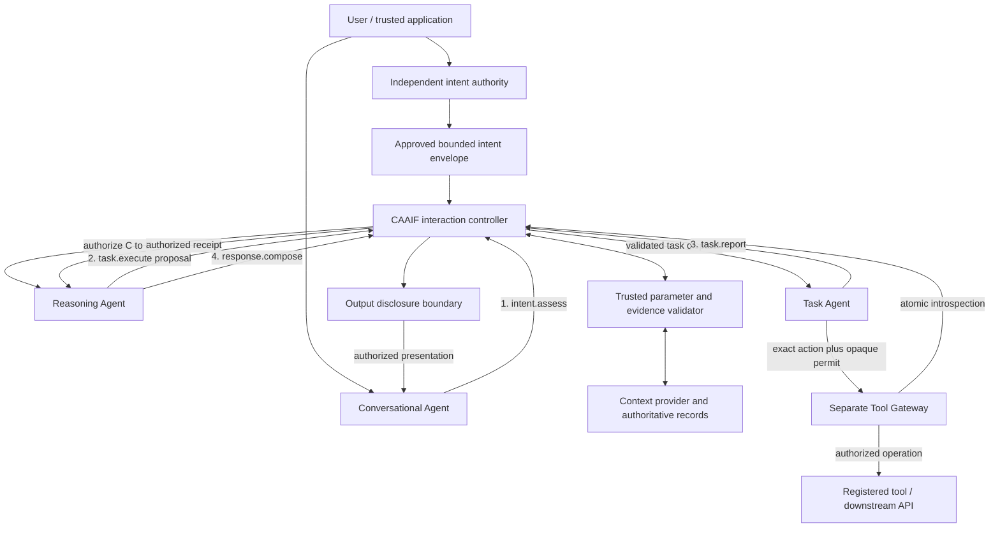
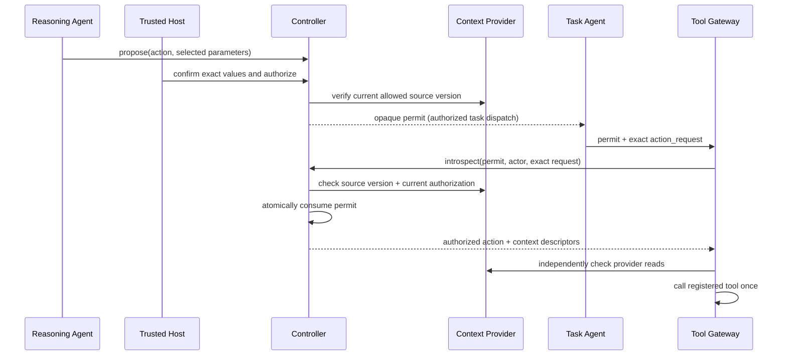

# CAAIF: Independently Authorized Agent Collaboration with Bounded User Intent and Controlled Context

**Context-Aware Agent Interaction Framework (CAAIF)**  
**Internal research working paper v3.1 (v0.14 experimental update)** · 18 October 2026  
**Code basis:** immutable RC1 baseline `v0.1.0rc1`, with additive research branch `research/v014-bounded-intent`.  
**Status:** preliminary, non-peer-reviewed, private repository, no public distribution approval; not a production security assessment. Author and affiliation to be formally designated before external submission.

## Abstract

Multi-agent AI systems must let models discover and propose actions without granting those models—or the documents they read—authority over protected effects. CAAIF investigates a transport-independent interaction-control layer in which independently approved intent constraints, contract-scoped agent relationships, authorized context projections, and execution-time tool checks define the boundary of delegation. The v0.14 prototype moves beyond exact pre-specified parameters: a trusted application may approve bounded intent, the Reasoning Agent may derive concrete values, and trusted resolvers and optional post-proposal confirmation validate those values before a separate Task Gateway executes a registered operation. For the guarded distributed research path, the Controller issues online, single-use opaque permits rather than sharing its permit-signing key with the Gateway. Deterministic tests exercise both legitimate bounded tasks and attempted unauthorized deviations across local and six-process localhost configurations. We state where user authentication, information-flow assurance, distributed isolation, and real-model utility remain unproved, and define comparisons designed to falsify the claimed practical benefit.

**Keywords:** agent interoperability; bounded delegated authority; prompt injection; context provenance; policy enforcement; human confirmation; capability control; multi-agent systems.

## 1. Contribution and scope

CAAIF is **not** a new LLM, a mandatory agent programming framework, a novel cryptographic token standard, a general-purpose context database, or a replacement for Agent2Agent (A2A) or Model Context Protocol (MCP). Its research object is the boundary between *model-originated proposals*, *policy-enforced authority* and *the minimum evidence available to each recipient*.

We study whether a reusable implementation can combine four properties across heterogeneous agents:

1. The user or application approves an **intent envelope** that bounds delegated action without pre-fixing every runtime parameter.
2. A **separate, deterministic enforcement authority** checks model-derived values and trusted evidence before an action receives a permit.
3. A **context provider** projects only permitted fields at retrieval time, independently of whether the bytes are sent inline, referenced, cached or delta-encoded.
4. An independent **tool execution gateway** rechecks current policy and single-use permission for the precise operation, while agent collaboration retains framework-neutral contracts.

Existing research already addresses capability security, information flow, policy engines and prompt-injection resistance. CAAIF's prospective contribution is the *cross-agent integration and interoperability semantics*, **not originality of those ingredients**. This composition only merits a substantive research claim if real workloads show useful security/utility or governance benefits over equivalently controlled alternatives.

### 1.1 Version terminology

| Label | Meaning |
|---|---|
| `0.1.0rc1` | Frozen Python package developer-preview candidate, privately tagged in GitHub |
| `v0.12` | Prior *local* guarded-trust research implementation |
| `v0.13` | Prior *distributed localhost* guarded reference and HMAC permit fixture |
| `v0.14` | Additive bounded-intent and opaque-permit research implementation, **not a release** |
| `1.0.0-draft.2`, `draft.3` | Historical/specification design axes; neither is an adopted protocol standard |
| Paper `v3.1` | Present revised research narrative and evaluation protocol |

## 2. Task model and the origin of authority

A useful agent cannot always know exact tool parameters at task start. Consider a synthetic accounts-payable task: “Prepare a payment for the verified supplier invoice, if the amount is within the agreed limit; ask me to confirm the final details.” At the outset, the user knows a *goal and boundaries*. The document may provide an amount; the approved supplier ledger provides the authorized beneficiary account. The invoice may also contain a malicious instruction to change the destination or send confidential data externally.

The initial exact-intent profile required the trusted host to fix the action, resource and **all parameters** before the Reasoning Agent proposed anything. That limited prompt-injection side effects, but either eliminated meaningful data-dependent discovery or deferred the real trust decision to an unexamined application component.

The v0.14 prototype therefore distinguishes:

- **Bounded authorization:** the user, in an authenticated host-controlled UI, or an approved deterministic application policy establishes allowable actions, resource, purposes, numeric bounds, acceptable values, authoritative source lookups, context versions and expiration.
- **Untrusted proposal:** the Reasoning Agent extracts/derives concrete values from relevant context. This is a suggestion, even if well-formed and attached to a valid Reasoning role.
- **Independent evidence validation:** approved resolver code re-reads authoritative data and checks proposal values; neither retrieved text nor self-labelled model metadata can grant access.
- **Exact-value approval:** if policy requires it, the trusted host obtains confirmation for the exact post-reasoning parameter set before asking the Controller to issue an execution permit.
- **Execution authorization:** the Controller checks the envelope, actual values, source and policy; a separate Gateway validates again immediately before a registered effect.

An `approval_reference` is **not** cryptographic proof of consent. The local and six-process prototypes **assume** the host integration independently authenticates the initiating person and records a genuine UI approval or already approved service policy. If the host simply forwards an LLM-produced intent as if it were approved, the security argument fails. Authenticating that approval ceremony remains required engineering work rather than an accomplished guarantee.

## 3. Threat model

**Protected assets:** user-granted action authority; tool credentials; trusted supplier/resource records; permitted context projections; sensitive model output; profile relationships; decision/audit integrity.

**Adversaries in the current experiments:** untrusted retrieved documents and tool output, model-generated proposals beyond approved limits, attempted role and parameter forgery, stale context, replayed tool execution and unauthorized downstream recipients. They may influence agent-generated text but do not possess the trusted host, Controller or Tool Gateway service credentials.

**Out of current experimental threat coverage:** malicious code executing inside a trusted host, a compromised Controller/Provider/Gateway, leaked bearer credentials, unauthenticated end-user interactions, OS/network bypass, colluding multi-tenant runtime workers, full natural-language information-flow taint tracking and side channels through which proposals or responses reveal restricted data.

The local profile protects against modeled agent misbehavior, **not** arbitrary Python running in the same process. The distributed prototype uses six independent OS processes but static localhost bearer tokens, not production workload identity or TLS.

## 4. Architecture and four governed role edges

The CAAIF Core is agent-count neutral. The optional Three-Agent Reference Profile assigns dialogue to a **Conversational Agent**, planning/proposals to a **Reasoning Agent**, and tool invocation to a **Task Agent**. The controller is deterministic infrastructure—not a fourth model agent.

**Figure 1 — Proposed governed architecture.** All four role-to-role edges are explicitly shown crossing the controller; the Gateway checks the additional protected effect. This is the *target architecture*, not a statement that all four distributed edges are fully wired in the v0.14 localhost prototype. The current implementation hardens the Reasoning→Task path; a complete distributed end-to-end return gateway and physical bypass prevention remain open.

### 4.1 Mandatory decision checkpoints

For a protected effect, checks occur at envelope registration, proposal assessment, independent policy evaluation, optional exact-value confirmation, permit issuance, dispatch, Tool Gateway introspection, Context Provider retrieval and output release. No prompt, agent role string, context reference, model-made decision record or cached context can independently grant permission.

### 4.2 Context projection is not transport selection

The Context Provider decides **which fields** a recipient is authorized to receive using principal, purpose, scope, resource version, policy, provenance and revocation. Inline/reference/cache/delta are **transport choices among already authorized projections**. A context reference is only a locator, not a bearer grant. A cache hit must not bypass current authorization. This distinction remains the central architectural hypothesis, separate from network-byte optimization.

## 5. Bounded intent and parameter validation

The v0.14 rule evaluator defines four explicit mechanisms:

| Kind | Example | Effect |
|---|---|---|
| `exact` | `mode = prepare-only` | Forbid changing stage of business operation |
| `one_of` | `currency ∈ {EUR}` | Choice limited to a trusted set |
| `decimal_range` | `0.01 ≤ amount ≤ 5000.00` | Decimal-string numeric envelope, no float coercion |
| `trusted_lookup` | `beneficiary_iban` from verified supplier registry | Proposal must agree with host-owned resolver's current source/value |

All parameters must match the explicitly declared field set. Unknown rule kinds, invalid ranges, missing/extra fields, unregistered resolvers and mismatched sources fail closed. The authorized parameter candidate is bound to the final permit by a canonical digest; it is not editable by the Task Agent. The bounded intent cannot be widened after registration.

### 5.1 A complete synthetic workflow

1. An independently trusted UI accepts the user's upper bound, verified supplier selection and instruction to **prepare only**. It stores an envelope linked to an authenticated approval event (the *real authentication proof is not implemented in this prototype*).
2. An untrusted invoice is ingested with external-source classification and constrained allowed purposes.
3. The Reasoning Agent extracts a candidate amount, currency and beneficiary and proposes `payment.prepare`.
4. A trusted lookup verifies the beneficiary against supplier-master data. A candidate attacker-controlled account is denied, regardless of invoice text.
5. Before authorization, the host requires exact-value confirmation of the amount and beneficiary. Changes between the presented values and the proposed parameter digest are denied.
6. The Controller checks policy, active versions and confirmation; it grants a short-lived opaque permit for the approved `payment.prepare` action.
7. The Tool Gateway introspects and consumes the permit, checks current context and runs only a registered synthetic preparation operation.
8. Any actual payment execution would require a **separate** approved capability, suitable segregation of duties and an independently enforceable banking authorization path. **No live payment is attempted.**

In test fixtures a trusted supplier resolver checks a synthetic registered account, and confirmation is simulated through the host-only API. These tests evaluate enforcement logic, not an authenticated human ceremony or banking policy.

## 6. Permit architecture: online opaque authorization

The v0.13 localhost proof used an HMAC-signed claim set shared between Controller and Tool Gateway, plus introspection. That coupling gave the verifier unnecessary access to a signing secret and did not justify the duplicate signature/introspection overhead.

The new v0.14 mode uses a random, opaque Controller-stored reference. Only the Controller can issue a valid reference; the Gateway holds no permit-signing key. Before execution, the Gateway authenticates itself to the Controller and sends the opaque reference, its Task principal and the **exact** action request. The Controller checks intent, bounds, confirmation, policy version, contract, proposal, tool audience, parameter digest, context freshness, expiry, revocation and single-use status. It then **atomically consumes** the permit while holding its local service lock. A second introspection for that reference is denied.

**Figure 2 — Online, one-time permission.** Choosing introspection makes revocation checks explicit but adds round trips and requires availability of the Controller. It is intentionally not a signed offline token. Both Controller and Gateway keep state in memory in this prototype; authorization after restart is denied but durable multi-node atomicity and downstream idempotency are **not established**. A lost response may be an ambiguous effect, not permission to retry.

## 7. Information-flow control and disclosure limitations

CAAIF's prior local `ContextProvenance` combines maximum sensitivity classifications and intersects allowed recipients/purposes/actions across declared inputs. That resembles classic lattice-based information-flow control and should be credited to the Denning lineage; it is not a novel IFC algorithm. The current prototype cannot soundly trace arbitrary LLM transformations or guarantee that the trusted host supplied complete source lineage. A proposal can leak information through tool parameter strings; a result can leak it through `response.compose`; even proposed action choice can be a side channel.

Future enforceable output mediation must track trusted source identifiers and receiver-authorized projections across *all four* profile edges, define a declassification authority (distinct from the model), prohibit raw-text declassification in prompts, and physically require user-visible or external output to pass through a disclosure enforcement point. A model-generated citation is not a trusted provenance proof. These are **requirements**, not implemented guarantees.

## 8. Implementation and evidence

The new code is additive; the original `LocalController.issue_decision(...authorized=True)` path remains for historical experiments and must not be used as protection for side effects. Opt into `GuardedLocalController` and the experimental v0.14 distributed mode for protected research fixtures. No change was made to the tagged RC1 release, license or default public visibility.

### 8.1 Observable test outcomes

| Evidence | Observed outcome | Scope |
|---|---|---|
| Original SDK suites | 161 tests passed across 12 modules | Regression compatibility |
| New local bounded-intent suite | 23 tests passed | Constraint matching, trusted resolver, later confirmation and revocation |
| New distributed v0.14 suite | 13 tests passed | Six independent loopback processes, opaque introspection, negative and concurrency cases |
| **Combined completed module outcomes** | **197 tests passed across 14 SDK modules** | Run was interrupted before all modules completed together; three remaining modules ran successfully separately |
| Local Three-Agent profile suite | 15 passed | Contract/profile invariants; not fully enforced distributed role paths |
| JSON schema fixtures | 14 validated | Syntax/shape, not runtime authorization |
| Release-preparation suite | 9 passed | Package/release checks |
| License/security release gate | BLOCKED | Intentional: approvals remain pending |

These are developer-run deterministic regression results, **not independent adversarial experiments**. They exercise selected negative cases, not 200 adaptive attacks or actual end-user authentication. The absence of successful bypasses among these tests should not be extrapolated to all possible model behavior.

### 8.2 Historical efficiency findings

Earlier localhost, synthetic context workloads observed a reduction in **HTTP JSON-body transfer** from 28,070 B to 17,677 B (about 37%) for one reused larger-context scenario when compared with selected inline, including mock publication/policy calls. That result belongs in a historical appendix, not in the abstract or a cost/superiority claim: headers, network/TLS, actual model tokens, context-window occupancy, quality and equivalent-control competitors were not measured. Small contexts sometimes favored inline delivery. The first meaningful efficiency metric in the next study is **unnecessary information delivered to the recipient and model-input tokens at equal task utility and control strength**.

## 9. Relationship to existing work

| Prior work | Established focus | CAAIF research hypothesis, not an established advantage |
|---|---|---|
| CaMeL (2025) | Separate control/data flow; capabilities restricting unauthorized uses | Externalize comparable controls as portable cross-agent interaction contracts and projections |
| Fides (2025) | Confidentiality and integrity labels, planner primitives, deterministic information-flow policy | Combine policy-grounded context with independently authorized cross-runtime handoffs, without claiming sound IFC yet |
| Progent (2025) | Programmable privilege controls over tool-use execution and dynamic policies | Combine tool privilege with a common contract and authorized context plane across multiple agents |
| IsolateGPT (NDSS 2025) | Architectural isolation among LLM components/apps | Complement isolation with independent intent, context and delegation semantics; not replace workload isolation |
| A2A / MCP | Agent task/discovery transport; tool and resource invocation | Define extension/profile semantics over existing protocols, not an incompatible replacement |
| XACML / Cedar / OPA | Independent policy administration, decision and enforcement | Reuse proven policy abstractions rather than inventing a new authorization language |

A close comparison must test **similar policy strength** and **equal user confirmation costs** in all systems. Simply adding more gates to an unguarded baseline would not establish substantive novelty. The literature on label lattices, declassification, dual-LLM isolation and capability tokens must be cited for prior ideas rather than claimed as new.

## 10. Falsifiable research agenda

| Question | Primary metrics | Planned experimental comparison / failure condition |
|---|---|---|
| RQ1: Does bounded approval retain usefulness without unauthorized action? | Benign task success, false denial, unauthorized effect success, confirmation workload | Real-model AgentDojo plus synthetic invoice tasks; compare with exact-intent guarded and equivalent-control flexible-policy baselines; measure at fixed security requirements |
| RQ2: Is less irrelevant information disclosed at equal utility? | Excess fields/bytes visible to each recipient; tokens passed to each model; output quality | Direct controlled handoff and policy-equivalent A2A vs selective-inline and referenced CAAIF; matched tasks/data/scopes |
| RQ3: Is multi-runtime adoption meaningful? | Adapter implementation effort, semantic mapping loss, unsupported cases, bypass surface, policy drift | LangGraph/Microsoft Agent Framework and an independent compliant A2A runtime with identical contracts |
| RQ4: Does the deployment enforce promises beyond a single process? | Unauthorized call success, replay after crash, stale-data race, revocation p95/p99, failure recovery | TLS/mTLS or SPIFFE-backed multi-node setup, egress isolation, injected failures, independent security review |

### 10.1 Experiment reporting protocol

Use identical model versions, prompts, policies, host confirmation UX, tool datasets and hardware for each matched configuration. Report task/attack counts, completed tasks, unknown outcomes, failures, latency distributions, actual LLM prompt/completion tokens, local/provider calls and cost. Register the primary metric and hypothesis thresholds **before** observing the benchmark, including treatment of withheld/uncompleted tasks. Evaluate at least one adaptive adversary, not just a fixed injection string; report attack success **and** legitimate-task utility side by side.

Zero observed bypasses among 200 independent trials would yield a Wilson 95% upper confidence limit of approximately **1.9%**, not a proof of universal prevention. Confidence calculations must match the actual test sampling design.

### 10.2 Exit gates before broader assurance

A production claim needs authenticated user approval provenance, isolated tool credentials with no alternate path, mandatory four-edge profile mediation, trusted end-to-end egress constraints, durable nonce/idempotency semantics, revocation-race testing and an independent network/model adversarial assessment. An open-source preview, if pursued, additionally needs explicit owner/legal/security release approvals, not merely passing CI. This document makes **no request to change that decision**.

## 11. Conclusion

CAAIF's v0.14 development demonstrates a more useful separation than the prior exact-intent prototype: the model can derive data-dependent candidate parameters while host-approved constraints, independent trusted lookups and optional later confirmation remain outside the model's authority. The second improvement is an online Controller-held single-use authorization that requires no shared Gateway permit-signing key. Deterministic tests show these mechanisms behave as specified under selected local and six-process hostile-input scenarios, while retaining RC1 regression compatibility.

The work has **not** demonstrated real-model prompt-injection resistance, genuine authenticated approval, sound model-output provenance, full distributed four-edge enforcement or an advantage over capability-controlled and information-flow-controlled systems. Those are the questions the next research phase must answer. The appropriate interpretation is a testable, increasingly complete security-and-interoperability **research prototype**, not a production standard or externally reviewed result.

## References and reproducibility

1. Debenedetti et al. (2025). *Defeating Prompt Injections by Design (CaMeL).* https://arxiv.org/abs/2503.18813
2. Costa et al. (2025). *Securing AI Agents with Information-Flow Control (Fides).* https://arxiv.org/abs/2505.23643
3. Shi et al. (2025). *Progent: Programmable Privilege Control for LLM Agents.* https://arxiv.org/abs/2504.11703
4. Wu et al. (2025). *IsolateGPT: An Execution Isolation Architecture for LLM-Based Agentic Systems.* https://www.ndss-symposium.org/ndss-paper/isolategpt-an-execution-isolation-architecture-for-llm-based-agentic-systems/
5. Debenedetti et al. (2024). *AgentDojo: A Dynamic Environment to Evaluate Prompt Injection Attacks and Defenses for LLM Agents.* https://arxiv.org/abs/2406.13352
6. Denning (1976). *A Lattice Model of Secure Information Flow.* Communications of the ACM. https://doi.org/10.1145/360051.360056
7. Beurer-Kellner et al. (2025). *Design Patterns for Securing LLM Agents against Prompt Injections.* https://arxiv.org/abs/2506.08837
8. Cedar Authorization, policy request semantics. https://docs.cedarpolicy.com/auth/authorization.html
9. Open Policy Agent. https://www.openpolicyagent.org/docs/
10. OASIS. *eXtensible Access Control Markup Language (XACML) Version 3.0*. https://docs.oasis-open.org/xacml/3.0/xacml-3.0-core-spec-os-en.html
11. SPIFFE workload identities and SVIDs. https://spiffe.io/docs/latest/spiffe-about/spiffe-concepts/
12. IETF RFC 8693. OAuth 2.0 Token Exchange. https://www.rfc-editor.org/rfc/rfc8693
13. CAAIF private project artifact. `https://github.com/MozesR/caaif-core/tree/v0.1.0rc1` (RC1 source tag; **not publicly accessible**).
14. CAAIF private research branch. `https://github.com/MozesR/caaif-core/tree/research/v014-bounded-intent` (experimental; **not publicly accessible**).

### Artifact status

The tests, experimental source and explanatory specification accompany the **private** research branch. No public archive DOI, blinded evaluation artifact, open-source license or external peer-review status is claimed. The paper should be revised after equivalent-control real-model evaluation before external submission.
