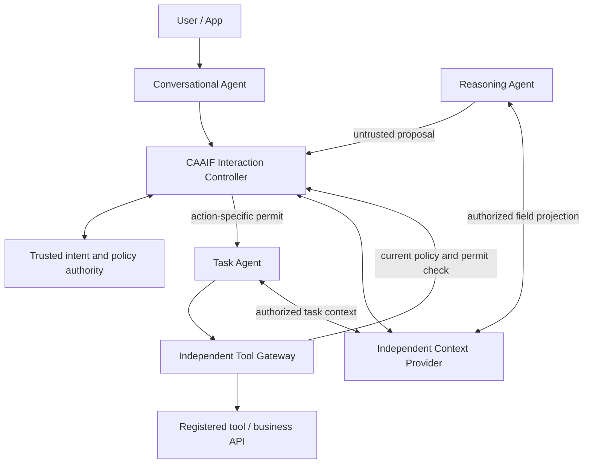

# CAAIF Core RC1 — Architecture

## Control, context and execution

- The Core does not require three roles. The optional Three-Agent Profile establishes a Conversational / Reasoning / Task split with contract checks on all four logical edges, including return flows.
- Context selection (the *authorized projection*) is a security decision. Its transport (inline, ref, cache, delta) is a separate performance decision.
- The Reasoning Agent is **not** a policy authority; it can only propose. A trusted host controls intent registration, contract registry and policy.
- The Task Agent must reach protected tools only through an independently enforcing Tool Gateway, and protected output must pass a disclosure gate.
- Existing A2A and MCP are interoperability substrates; CAAIF does not claim to be a ratified replacement wire protocol.

## Profiles

| Profile | Status | Intended use |
|---|---|---|
| Legacy Local (`LocalController`) | Historical research compatibility | Local controlled interactions, not protected side effects |
| Guarded Local (`GuardedLocalController`) | Tested opt-in local proof | Protected operation semantics within trusted Python host only |
| Guarded Distributed (`distributed_guard_v013`) | Tested localhost multi-process reference | Demonstrate signed action-bound local proof, external gateway and provider checks |
| Production Guarded Profile | Design requirements only | Requires workload identity, TLS, trusted registry, durable replay, network isolation and security review |
