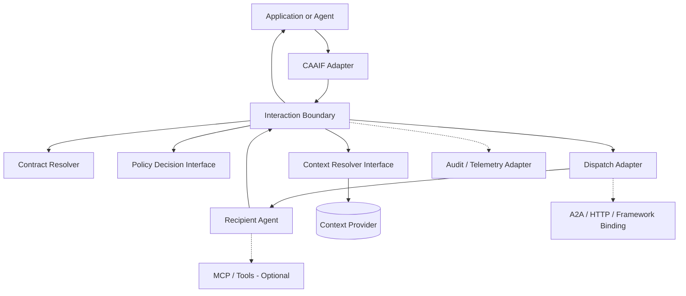
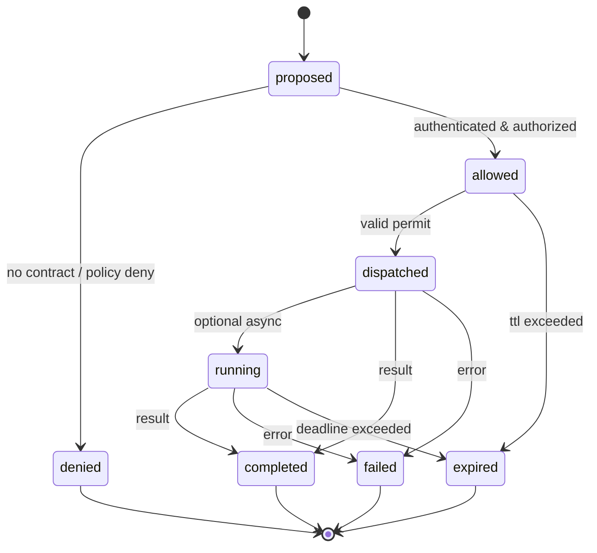

> **Status: historical architecture draft.** For effectful work, the guarded trust boundary in `spec/TRUST_ARCHITECTURE_DRAFT3.md` and `spec/GUARDED_DISTRIBUTED_PROFILE_V013.md` supersedes any assumption that an LLM-produced decision is an authorization. This is a developer preview, not a stable security standard.

# CAAIF Core v1.0 — Architecture and Protocol Specification

**Status:** PUBLIC REVIEW DRAFT — not an adopted or published standard  
**Version:** `1.0.0-draft.2` (October 17, 2026)  
**Project:** Context-Aware Agent Interaction Framework (CAAIF)  
**Scope:** General-purpose, vendor-neutral control and context semantics for interactions between independently developed agents.

> **Design thesis:** An agent may reason and propose actions autonomously, but an independent enforcement boundary decides whether an interaction is permitted and which contextual evidence may be accessed. Exchange only the information required for the authorized capability.

## 1. Problem and contribution

Agent systems can exchange requests through HTTP, A2A or framework-native APIs. The recurring architectural problems are that handoffs resend large amounts of context, the permission to speak or act is often implicit, and interaction enforcement may reside entirely in agent prompts. CAAIF defines a small **interaction contract**, a **policy-governed proposal**, a **context-reference** abstraction, and an **enforced dispatch boundary**. It does not try to replace A2A, MCP, LLM tool calling, or an existing workflow engine.

CAAIF's potential distinct contribution is the **combination** of context minimization and externally verifiable interaction permissions. Novelty and efficiency compared with related systems remain **hypotheses** requiring independent measurement.

### Goals

1. **Portability** — a caller and recipient can use different frameworks or programming languages.
2. **Minimal exchange** — small information may be inline; large/reused context may be referenced, scoped and fetched on demand.
3. **Enforced interaction control** — permission is checked at a boundary outside the requesting agent's prompt.
4. **Clarity** — two agents can use a local embedding without mandatory distributed infrastructure.
5. **Composability** — A2A transport, MCP access, identity, storage, and policy implementations are adapters.
6. **Testability** — a conformance suite can reject implementations that bypass mandatory checks.

### Non-goals

- Creating a replacement for A2A agent discovery and task exchange.
- Mandating an agent taxonomy or a three-agent pattern **for all CAAIF users**. The optional Three-Agent Reference Profile makes the Conversational–Reasoning–Task separation enforceable for applications that declare it.
- Prescribing LLM providers, prompt chains, or planning algorithms.
- Building a durable workflow engine, consensus system, global agent registry, or universal context database into the core.
- Claiming exactly-once execution of effects in external systems.
- Requiring all context to be stored in one global place, or transmitting model-private chain of thought.

## 2. Conformance terminology

**MUST**, **MUST NOT**, **SHOULD**, and **MAY** are normative when written in capitals. This is a proposal; conformance labels apply only to this draft, not to any existing standards body.

Two deployment profiles are defined:

- **Local Profile (L):** library-mode admission and dispatch for one trust domain. A caller MUST NOT be able to bypass checks through the published CAAIF API, but code sharing the same process can often bypass the boundary; no claim of strong process isolation is made.
- **Guarded Profile (G):** external independently enforced gateway/sidecar/runtime boundary. Peer identity MUST be authenticated by the transport and bound to contract authorization; context and dispatch backends MUST enforce permissions. Production deployments MUST block alternate bypass paths.

The **core semantics and envelope** are shared by both profiles. The Guarded Profile adds stronger deployment and identity requirements; it does not change the message format.

### Optional first-class Three-Agent Reference Profile

CAAIF Core remains agent-count neutral. Applications that declare `caaif.profile.three-agent.v1` MUST enforce distinct **Conversational, Reasoning and Task** agent roles, allowed interaction edges, validated Reasoning-to-Task decision references and independent effect/tool policy. The **Interaction Controller is deterministic infrastructure, not a fourth agent**. See [`THREE_AGENT_PROFILE.md`](THREE_AGENT_PROFILE.md) and [`../diagrams/three_agent_profile.png`](../diagrams/three_agent_profile.png).

## 3. Logical architecture

**Six mandatory logical responsibilities** (may be in-process in Profile L):

| Responsibility | Normative role |
| --- | --- |
| Identity binding | Associate an authenticated principal with a declared `caller_id`; no trust in caller-supplied strings alone |
| Contract resolver | Resolve immutable `contract_id` + version and permitted capability/recipient/scopes |
| Policy decision | Return allow/deny with bounded reason; deny by default; evaluate business conditions separately |
| Context resolver | Resolve references by scope and version, reauthorize at access time |
| Dispatch boundary | Deliver an authorized request to its chosen recipient; prevent permit substitution |
| Outcome/event interface | Correlate decisions and outcomes; emit redacted audit metadata |

**Optional adapters:** discovery (including A2A Agent Cards), HTTP/gRPC/A2A bindings, OCP or other context stores, OPA, Redis/SQL, approval engine, durable retry coordinator, MCP authorization gateway, observability backend.

A production deployment MUST treat the interaction boundary and any downstream tool gateway as separate enforcement points. A proposal alone is not approval for real-world effects.

## 4. Canonical domain objects

These objects are specified by JSON Schemas under `../schemas/`.

### 4.1 Interaction Contract

A contract defines a narrow, reviewable permitted edge (who may request what capability from whom and with what context). Mandatory fields:

- `contract_id`: stable identifier, interpreted within a trusted namespace.
- `version`: immutable contract version (new rules require a new version).
- `caller_id`, `recipient_id`, `capability`: exact values, no wildcard interpretation in v1.0 core.
- `context_policy`: allowed scope names, inline byte ceiling, maximum number of references.
- `profile_binding` (optional): for profile-governed contracts, immutable profile ID/version and the permitted caller/recipient roles. Base CAAIF contracts need not set this field.
- `effect`: `read_only` or `effectful`. Effectful operations require a durable receiver-side idempotency strategy and an additional action authorization boundary.
- `limits`: TTL and maximum serialized request bytes.

Contract creation, publication, signatures, delegation, and dynamic discovery are **out of core scope**. Contract stores and version negotiation can be plugged in.

### 4.2 Interaction Request

One proposal describes an intended capability and relevant context:

- `spec_version`: protocol draft discriminator.
- `request_id`: globally unique per logical interaction, stable across retries; same ID with different content MUST be denied.
- `correlation_id`: trace/workflow correlation identifier, **not** an authorization credential.
- `contract_id`, `contract_version`, `caller_id`, `recipient_id`, `capability`: claimed values checked against the authenticated principal and resolved contract.
- `context_refs`: zero or more `{ref,version,scope}` descriptors; these are **opaque identifiers**, not grants and not arbitrary fetch URLs.
- `input`: small, capability-specific structured data. No automatic trust of arbitrary inline fields.
- `expires_at`: RFC 3339 timestamp to limit the interaction lifetime.
- `decision_ref` (optional in core): a non-authoritative locator of a trusted Reasoning decision; required and independently validated for protected Reasoning → Task requests under the Three-Agent Reference Profile.
- `idempotency_key`: MUST be present for any `effectful` contract; receiving systems MUST verify idempotency themselves.

Requests MUST NOT contain raw secrets, tokens, full unrelated conversation history, or unrequested personal/sensitive data. Schema validation is necessary but not sufficient for data minimization.

### 4.3 Interaction Decision and Permit

The boundary returns `allowed` or `denied`. An allowed decision references a **short-lived permit** bound at least to:

`request_id`, authenticated caller identity, contract identifier/version, recipient identity, capability, accepted context scopes, and expiration.

A `permit_id` by itself MUST NOT be treated as authorization. In Profile G, a permit MUST be unforgeable (e.g., server-side lookup or cryptographic token), have restricted audience, and be checked at dispatch. Revocation and time-of-use checks apply to the live permission, not only to the original decision.

Denials MUST use a machine-readable reason code. Avoid revealing sensitive policy internals to callers.

### 4.4 Context Reference

`{ "ref": "ctx:project/document-42", "version": "v3", "scope": "project.documents.summary" }`

`ctx:` is **illustrative, not a registered URI scheme**. Providers MAY use other opaque identifiers. The reference is a locator, never a bearer credential.

Context providers MUST verify recipient identity, contract/permit scope, tenant/workspace authorization, version, expiry and revocation *at each access*. They MUST NOT follow arbitrary remote URLs from untrusted agent input, nor silently substitute a different version. If changed, return `context_version_conflict` and require a new decision where appropriate.

The resolver SHOULD return **only authorized projections** of large resources. Inline vs reference is adaptive: use references when cost of resending exceeds secure lookup overhead, not simply because a reference is possible.

### 4.5 Result and Events

The recipient returns a result correlated by `request_id` and optionally used context versions. Standard terminal outcomes are `completed`, `failed`, and `expired`. Valid intermediate states are `proposed`, `allowed`, `dispatched`, and (optionally) `running`.

The audit/telemetry interface MUST emit structured records for decision, dispatch, context resolution, completion, denial, and failure. Audit records SHOULD contain IDs, reason codes, latency, sizes, policy/contract versions, but MUST NOT contain secrets or raw context by default. Persisted event delivery is optional, not a core requirement.

## 5. Protocol operations and semantics

CAAIF v1.0 defines **logical operations**, not a mandatory network protocol:

1. **`propose(request, authenticated_principal) -> decision`**: validate envelope, bind identity, resolve contract, evaluate policy and return a bounded permit or denial.
2. **`dispatch(request, permit) -> result | receipt`**: revalidate binding/expiry/revocation, deliver to recipient adapter, correlate outcome.
3. **`resolve_context(ref, principal, permit) -> projection`**: authorize at access time and return an explicitly scoped, immutable-version projection.
4. **`observe(event)`**: record redacted lifecycle metadata; may be an in-memory callback in Profile L.

An implementation MAY combine `propose` and `dispatch` in one transport round trip **provided it does not skip any checks**. This avoids a normative five-request workflow. Asynchronous receipts, event subscriptions, cancellation, approvals, and durable retries are extensions.

### Mandatory processing order

1. Parse with size and schema bounds.
2. Authenticate the transport caller (Profile G) and resolve its principal.
3. Verify the claimed caller is bound to that principal; identify the recipient.
4. Validate contract/version/capability and proposed context scopes.
5. Evaluate independent policy, timeouts and operational constraints; default deny.
6. Issue a bound, short-lived authorization decision.
7. Before dispatch, check permit audience, expiry, policy revocation, current subject and context version.
8. Recipient resolves only its authorized context, executes within its capability limits, and returns outcome.
9. Emit observable decisions and outcomes, including denials, without raw reasoning traces.

### State machine

A terminal state MUST NOT be re-entered by repeating the same `request_id`. A retry MAY return a previously recorded result. For effectful operations, ambiguous results MUST cause `outcome_unknown` or equivalent hold/reconciliation; NEVER silently re-execute an external effect.

## 6. Security and trust boundaries

- **Identity:** use transport-authenticated identity, never self-asserted `caller_id` as proof. Per-service secrets or workload identities are deployment matters. No common master secret requirement.
- **Authorization:** deny by default; bind contract/policy versions; scope context separately from action authority; enforce at tool/external system boundary too.
- **Isolation:** distinct principal and tenant/workspace scope; profile G MUST prevent bypass (network, service credentials, target authorization).
- **Confused deputy / SSRF:** `context_refs` are not URLs to fetch without validation; resolver controls accepted provider namespaces and resource kinds.
- **Replay:** bind permits to request and caller; enforce expiry, one-use or bounded reuse; ensure request payload idempotency on retries.
- **Effects:** receiver-side idempotency or transactional APIs are mandatory for claimed safe effect retries; without this, return an uncertain state requiring reconciliation.
- **Data minimization:** no uncontrolled history propagation; no raw chain-of-thought logging; emit access decisions, evidence references and summaries instead.
- **Denials:** reject unknown versions/capabilities/scopes and when policy backend fails. Error messages are generic to the external caller.
- **Human approval:** if required by policy, use an extension with a verifiable approval artifact and fresh authorization at execution. No prompt-text approvals.

## 7. Interoperability model

**A2A** SHOULD be the first cross-framework adapter. Reuse A2A for discovery, task addressing and state as provided by its specification; CAAIF annotations and contracts MAY be carried using a separately specified A2A extension identified by a URI registered by the future CAAIF project. The mapping in `A2A_MAPPING.md` is **proposed, not a ratified A2A extension**.

**MCP** supplies tools/resources. CAAIF controls which agent may request a capability and scoped context; MCP gateway or server separately authorizes actual tool/resource execution. CAAIF MUST NOT treat a CAAIF decision as unrestricted MCP access.

**OCP** or another context infrastructure MAY implement `resolve_context`; OCP is **not** a normative dependency or proof of interoperability. Many unrelated projects use similar context-protocol names.

**OPA**, a rules engine, or a custom deterministic evaluator MAY implement the policy decision interface. The CAAIF core standardizes the decision semantics, not the policy language.

## 8. Profiles and declared conformance

| Capability | Local Profile (L) | Guarded Profile (G) |
| --- | --- | --- |
| Contract validation | MUST | MUST |
| Deny by default | MUST | MUST |
| Caller identity binding | trusted in-process binding | authenticated runtime/transport principal |
| Independent dispatch enforcement | logical interface | physically enforceable gateway/sidecar boundary |
| Context access-time ABAC | MUST | MUST |
| Version/expiry validation | MUST | MUST |
| Auditable outcomes | MUST | MUST |
| Durable workflow persistence | OPTIONAL | OPTIONAL |
| Disaster recovery / coordinator | OPTIONAL | OPTIONAL |
| External effects | safe execution contract | receiver-side enforcement + safe execution contract |

Public claims MUST identify the implemented profile and passed conformance tests. Passing JSON Schema tests alone is **not** CAAIF compliance.

## 9. Conformance testing and performance research

See `CONFORMANCE.md`. Tests MUST include mismatched caller identity, wrong capability, unauthorized scopes, expired/revoked permits, changed context version, duplicate request ID with altered payload, and unknown outcomes for effectful operations.

Benchmarks SHOULD report: full end-to-end latency (p50/p95/p99), number of transport requests, payload and header bytes, total context bytes copied, context versions retrieved, token usage with a real model, authorization-denial effectiveness, and complexity of integration. Compare with (a) bare HTTP as a speed floor, (b) an **equivalent-governance** implementation, and (c) a real A2A-compatible adapter. Document warmup, hardware, network, concurrency and statistical uncertainty.

**Prior prototype evidence:** a v0.5 local scenario used five internal calls / 1,520 request+response body bytes per workflow; v0.6.1 reduced this to four calls / 1,397 bytes. These results are *workflow-specific measurements supplied during prototype testing*, not CAAIF Core benchmarks and not evidence of advantage over A2A.

## 10. Versioning, extensibility, and release gates

- `spec_version`: a compatible envelope family; unknown major versions MUST be rejected.
- Contract version MUST be immutable. Changes to principals/capabilities/scopes/limits require version increment and new decision.
- Unknown required extension identifiers MUST cause a clear error, not silent ignore. Optional extensions MAY be ignored.
- Extension names/URIs are **provisional** in this draft; no domain name, official registration, or ecosystem endorsement is claimed.

To reach a stable 1.0 release, the project needs: independent review, a published namespace and governance policy, functioning Python SDK + reference adapter, A2A interoperability demonstration, conformance test suite, security threat model, license decision, and measured comparisons including context reuse.

## 11. Open decisions (for public review)

1. Should `request_id` identify the logical action across retries, or should a separate attempt ID be mandatory?
2. Should profiles be named `local` and `guarded`, or use formal levels of independently verifiable assurance?
3. Which minimal extension fields fit A2A metadata without duplicating A2A task identifiers?
4. What portable query/projection descriptor should the context resolver support without locking to one knowledge store?
5. How should permit revocation and human approval be surfaced without requiring central infrastructure?
6. How can the framework enforce context minimization across capability-specific arbitrary inline `input`?

## 12. Related specifications (reference, not inherited licensing)

- [Agent2Agent specification](https://a2a-protocol.org/v1.0.1/specification/) — agent communication, tasks, discovery and extensibility.
- [A2A extensions guidance](https://github.com/a2aproject/A2A/blob/main/docs/topics/extensions.md) — declaration and activation of optional extensions.
- [Model Context Protocol specification](https://modelcontextprotocol.io/specification/) — tools, resources and transport security.
- [Open Context Protocol / agent context](https://opencontextprotocol.io/docs/agent-context/) — possible context-layer inspiration, requiring separate maturity assessment.
- [Open Policy Agent documentation](https://www.openpolicyagent.org/docs) — optional policy evaluation implementation.

---

**Editorial note:** This is an original architectural proposal based on design experiments and public protocol documentation. It has **not** been submitted to or approved by any standards body. Do not publish as a stable standard until security, compatibility, and license reviews are complete.
