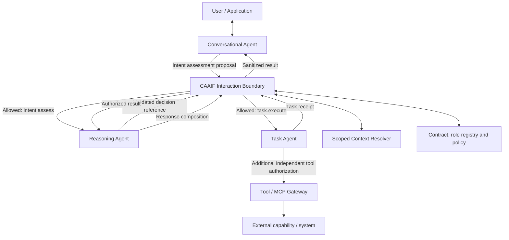

> **Status: historical architecture draft.** For effectful work, the guarded trust boundary in `spec/TRUST_ARCHITECTURE_DRAFT3.md` and `spec/GUARDED_DISTRIBUTED_PROFILE_V013.md` supersedes any assumption that an LLM-produced decision is an authorization. This is a developer preview, not a stable security standard.

# CAAIF Three-Agent Reference Profile v1.0 (Draft)

**Status:** PROPOSED **conformance profile**, not a mandatory requirement of CAAIF Core.
**Profile ID:** `caaif.profile.three-agent.v1`; **version:** `1`.

## 1. Purpose and compatibility

The **Conversational–Reasoning–Task** architecture is a first-class CAAIF reference profile. Applications opting into this profile MUST meet the role and interaction invariants below; applications using unprofiled CAAIF Core MAY use two agents, many agents, or another organizational pattern. **No particular LLM, framework, provider, prompt structure, or physical deployment topology is required.**

This is a profile on top of the `InteractionRequest`, `InteractionContract`, `ContextReference`, and authorization boundary specified in `CORE.md`; it does not fork A2A or require a new transport. An application MAY implement one role with deterministic code; distinct *logical principals* are required even when co-hosted, and co-hosting alone cannot claim strong isolation.

## 2. Role responsibilities

| Role | Owned responsibility | Forbidden shortcuts |
| --- | --- | --- |
| **Conversational Agent** | Dialogue, user-intent interpretation, clarification, result presentation | MUST NOT directly request protected Task execution or self-approve effects |
| **Reasoning Agent** | Evaluate relevant context, decide the plan, identify capabilities, propose bounded task authorizations | MUST NOT execute protected tools by disguising execution as reasoning; a proposed decision is not a permit |
| **Task Agent** | Perform explicitly permitted capabilities through separately authorized tool/API interfaces, report evidence/results | MUST NOT invent a Reasoning authorization, expand scope, self-authorize an effect, or return unrestricted raw evidence |

**Interaction Controller:** deterministic enforcing infrastructure, **not a fourth AI agent**. It resolves contracts, binds identity, verifies role paths, validates trusted decisions, checks policy and approved context, grants scoped dispatch and emits audit metadata. Independent tool/MCP policy remains required for effectful operations.

## 3. Required edges and direction of authority

The normalized profile interaction edges are:

1. `conversational → reasoning` (`intent.assess`)
2. `reasoning → task` (`task.execute`, requires a trusted Reasoning decision, independent policy, and effect idempotency)
3. `task → reasoning` (`task.report`)
4. `reasoning → conversational` (`response.compose`)

For the initial v1 profile, the four role-pair edges shown above are the **complete permitted graph**. Optional auxiliary agent types integrate via separate extension contracts without adding a bypass edge to this profile. Interactions are mediated through the **independent CAAIF boundary**, not direct unguarded network paths. A recipient role MAY have multiple agent implementations or instances. Optional Evaluator, Retrieval, Memory, Orchestrator and Ambient agent types MAY be attached through explicit additional contracts, but MUST NOT create an alternative path around mandatory task authorization. Parallelism and internal planning remain implementation-specific.

## 4. Normative guarantees for profile-conformant applications

**P01 — Role registry.** Every `agent_id` MUST resolve to precisely one profile role within the application's profile instance. The same agent principal MUST NOT occupy both Reasoning and Task roles for a protected action. Separate logical roles do not imply strong security isolation unless implemented by the Guarded Profile.

**P02 — Enforced edges.** The gate MUST match authenticated caller and recipient against the profile registry, exact contract ID/version and capability. Undeclared edges MUST be rejected. Especially, `conversational → task` MUST be rejected for protected task capabilities.

**P03 — Genuine Reasoning decision.** A `reasoning → task` request MUST include `decision_ref`, which MUST resolve to a trusted, versioned decision record already issued or registered by the authorized Reasoning principal. The independent gate MUST check binding to the same correlation, requested recipient, contract, capability, expiry and revocation state. The `decision_ref` is a locator, **not a bearer permit or proof by itself**. No raw chain of thought is required or collected.

**P04 — Separate effect authorization.** For any `effectful` capability, the gate and downstream tool boundary MUST perform independent policy authorization. The Task Agent MUST NOT use its reasoning decision record as sufficient tool authorization. Effectful delivery MUST use a receiver-side idempotency/reconciliation strategy; unknown outcomes fail closed.

**P05 — Minimum context.** Every role MUST request only scopes granted by its contract. Context references are opaque; retrieval-time checks MUST validate identity, version, tenant/workspace, purpose, expiry and revocation. The Conversational Agent's full transcript MUST NOT automatically be forwarded to Task.

**P06 — Structured results.** Task outputs SHOULD return an evidence/receipt reference or constrained structured result. Task → Reasoning and Reasoning → Conversational result edges MUST be policy checked and audited. Any user-visible response is the Conversational Agent's responsibility.

**P07 — Guarded conformance.** Production guarded deployments MUST block physical bypass routes and prevent identities from being forged by caller-provided role strings. Merely using JSON field names and diagrams does not qualify.

**P08 — Minimal adoption.** The profile adds **no required database, broker, scheduler, distributed lease manager, particular SDK, or orchestrator**. A single local controller implementation is permitted in the Local Profile (with weaker isolation guarantees).

## 5. Profile manifest, contracts, messages

- Manifest: `../schemas/three-agent-profile.schema.json` and `../examples/three-agent/profile.json`.
- One contract for each allowed edge: `../examples/three-agent/contracts/` with `profile_binding` recording permitted logical roles.
- Requests: `../examples/three-agent/requests/` using existing CAAIF `InteractionRequest` and optional `decision_ref` for guarded Reasoning → Task dispatch.
- Trusted Reasoning decision **test fixture**: `../examples/three-agent/trusted_decision_record.json`. In a real Guarded deployment this must come from a secure server-side store rather than from the requester.

A profile manifest MUST be verified semantically: JSON Schema alone cannot prove role disjointness, edge completeness, contractual match, decision authenticity or isolated enforcement.

## 6. How this relates to universal CAAIF Core

Core only: two arbitrary agents may exchange a permitted request and scoped context. Three-Agent Reference Profile: an application **opts in** and MUST then follow the three-role separation and explicit Reasoning→Task authority chain. Multiple agents per role, extra roles and workflows are possible, but the protected Task path cannot bypass the profile.

The reference example is synthetic document/outline processing; it **does not use banking business states**. Passing the included static fixture tests does not prove a production-secure runtime, interoperability with A2A, efficiency gains or full profile conformance.
